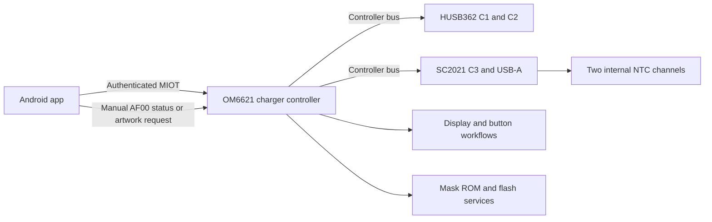

# AD1204U: capability inventory and remaining work

## Recent updates

Newest first.

- **2026-10-16, manager and thermal:** See [allocation transitions](firmware/allocation-transitions.md).
  - The C2 startup gate timer and the state updates before reconciliation are verified.
  - The bounded writer search found no rearm on disconnect or error.
  - Thermal heating and recovery both request new allocations.
  - Stage3 selects zero desired caps. Then recovery selects the lower budget
    without a reset in the host path.
  - 2,016 offline cases passed. Hardware acceptance and the integration with
    the continuous scheduler and bus are not verified.
  - App 0.7.1 did not change.
- **2026-10-16, allocation:** See [verified allocation policy](firmware/allocation-policy.md).
  - The policy keeps these items separate: protocol, reduction and load classes,
    destination voltage, connection timestamps, and caps that depend on the AC
    selector.
  - It keeps the normal fixed-scene rows.
  - It checks all four scenes across occupied masks and budget and variant selectors.
  - It shows one possible path to the reported 55/70 W pair.
  - AI low-load branches can give 22.5 W to one C port and keep 100/120 W for
    the other port.
  - These are offline host-policy results. There are no new controls and no
    hardware changes.
- **2026-10-16, settling:** See [protocol settling and control](firmware/protocol-settling-and-control.md).
  - Settling is enum-only after full-record changes. This is verified.
  - Disconnect and settling share one counter.
  - Power snapshots come from the previous cache. Reduction classes are kept.
  - No tuning route for `mUFCSCtrl` was found.
  - The SC copied tail bytes are set to zero at startup. No producer and no
    field consumer are known.
  - App 0.7.1 did not change.
- **2026-10-16, field trace:** See [controller field consumers](firmware/controller-field-consumers.md).
  - Measured voltage is a different word from the destination-voltage word
    that the firmware names.
  - The HUSB cache has one more host stack byte.
  - SC protocol validation can skip the protection-cache updates. This is verified.
  - The full bus-field map shows unknown words explicitly.
  - These findings add no BLE reading and no app control.
- **App 0.7.1, controllers:** See [secondary-controller research](firmware/secondary-controller-followup.md).
  - C3/A allocation code `0xa0` means 7.5 W. The app now shows this value and
    also keeps the raw code.
  - Tests with the original instructions show that SC2021 setting caches can
    stay after failed writes.
  - The bus addressing, the checksums and the shared-limit producer are mapped.
  - No separate controller firmware and no extra protocol unlock were found.
  - No hardware operation was done.
- **2026-10-16, plugin:** See the [plugin feature/write-path audit](firmware/plugin-feature-audit-20261016.md).
  - The plugin has a broken UFCS reset follow-up, incorrect batch reply pairing
    and miPPS writes to the wrong port.
  - The per-port mask readback in the firmware shows saved preferences. After
    legacy writes, these can be different from the desired controller settings.
  - Vendor guidance says that PPS depends on PD. C3/A protocol changes need a
    replug.
  - These are static findings. The app and the hardware did not change.
- **App 0.7.0:** See [direct signed-firmware installer](firmware/in-app-flasher.md).
  - It adds offline import, persistent packages, pinned signing-chain checks,
    resume with a CRC check, and authenticated version verification.
  - It is experimental. It works only on the China model with firmware 0073.
  - Not tested on hardware.
- **App 0.6.6:** See [protocol labels and raw pairs](firmware/app-protocol-labels-0066.md).
  - The labels now use the official plugin table.
  - C1/C2 09 keeps a tentative miPPS alias. USB-A 02 is not resolved.
  - [Developer/OTA plugin findings](firmware/plugin-debug-and-upgrade-followup.md)
    describe the other useful host paths. They add no charger writes.
- **OTA:** The [native transfer framing](firmware/ota-transfer-framing.md) now
  matches the [firmware receiver](firmware/ota-firmware-receiver-followup.md).
  This includes commit acknowledgements and resume with a CRC check.
  - The [validation/recovery review](firmware/ota-validation-recovery.md) keeps
    download checks, packet retries and final rediscovery separate.
  - ROM recovery and the behavior during a live interruption are not verified.
  - App 0.6.6 did not change.
- **2026-10-15, plugin:** The [official device plugin](firmware/mihome-charger-plugin.md)
  is downloaded and unpacked. This includes its active protocol display table,
  the protocol controls and the firmware and debug routes. This is new vendor
  UI evidence. The app behavior and the firmware-only inventory below did not
  change.

## Scope

Updated 2026-10-14. Target: China-model `njcuk.fitting.ad1204`, firmware
`2.1.2_0073`. Raw image SHA-256:
`65d96d0f6138a36fc62ce62325d055f934dac40d67bc31720f8182ebf5c80ce1`.

This is a bounded inventory of the analyzed image. It does not cover all
behavior of the hardware, the mask ROM, the secondary controllers or other
releases. The app implementation is experimental. Replies from users for
selectors 1/2/6 agree with these layouts. Calibration, freshness and write
behavior need separate checks.

## Available app controls and telemetry

| Capability | Route | What the app exposes | Evidence / remaining limit |
|---|---|---|---|
| Four port voltage/current/output readings | MIOT 2.1–2.4 | V, A, calculated W, active status, assigned cap | Cap byte is not the protocol; current/voltage resolution is 0.1 units |
| Total output | Derived from active-port readings | Sum of calculated port watts | No independent mains/input-power measurement |
| Charging protocol | MIOT 2.17/2.18 | Official QC/AFC/FCP/SCP/PPS/UFCS labels; C1/C2 PD Fixed/PD PPS; miPPS (likely) for C1/C2 09; visible raw pairs | Vendor display evidence is separate from negotiation proof; USB-A 02 conflict retained; cap watts only labelled for C1/C2 7/8 |
| Charging scenes | MIOT 2.5 | AI, Hybrid (Apple), Single, Balance | Hybrid is the vendor English name for the existing Apple profile; wire values unchanged |
| Port switches | MIOT 2.16 | C1/C2/C3/A on/off | Reads back setting; off stops charging on that port |
| Shutdown timers | MIOT 2.9–2.12 | Per-port minutes; zero cancels | uint16 range; separate optional read |
| USB-A keep-on | MIOT 2.15 | Existing switch | Firmware uses a roughly four-hour timer; not unlimited indefinite behavior |
| Display | MIOT 2.6/2.13/2.19/2.20 | Timeout, language, idle-off, orientation lock | No arbitrary screen injection |
| Protocol enable switches | MIOT 2.21 | C1/C2 PD/PPS/UFCS/miPPS; C3/A UFCS/SCP | New advanced controls; reserved bits preserved, write readback; config acceptance does not prove negotiated protocol |
| Two NTC readings | Vendor AF08 selector 2 | NTC2 shell input, NTC1 protection input | Converted/filtered caches; Celsius and physical sensor locations need hardware confirmation |
| Thermal snapshots and history | Manual Read sensors / Read all | Both NTC estimates, per-reply receive age and latest twelve sensor replies | Receive time is not firmware sample time; no automatic sampling or guessed stage |
| MCU temperature candidate | AF08 selector 2, byte 8 | Decimal low byte plus hex, units unconfirmed | Factory/default calibration path traced; 0x24 aliases full 292/36/-220/-476 in original-code fixtures |
| Power-control state | AF08 selector 2 | 9/16/22 V rail setting, PFC high/low control setting | Neither field is independently measured electrical feedback or a fault mask |
| AC sensing | AF08 selector 2 | Cached ADC proxy in logged mV; other diagnostic byte raw | Not direct mains volts or input watts; other ADC byte units unknown |
| Hardware variant | AF08 selector 2 | Global-hardware flag | GPIO-derived; separate from Xiaomi account/server region |
| Default/unbound conjunction | AF08 selector 2 | Read-only state byte in diagnostic details | False does not independently prove binding or identify an account |
| Native controller status | AF08 selector 6 | Four allocation codes, C1/C2 raw pairs, C3/A SC2021 native codes | Native and MIOT code spaces differ; faults read into logs are absent from reply |
| Controller versions | AF08 selector 1 | SC2021 software word, two version words per HUSB362, local revision and image CRC | MTU >=24; HUSB word roles/staleness unresolved; CRC is not bootloader version |
| Holiday startup artwork | AF07 selector 9, values 0/1 | Persistent cosmetic boot-graphic switch, verified reply | Visible after later reboot; no automatic reboot; durable persistence still needs hardware check |
| Firmware information and installation | FE95 version + optional cloud metadata + 0017/0018 | Download/export, offline signed-file import and experimental direct install | China model/current 0073 only; physical flashing and recovery unverified |
| Copy diagnostic report | Local app action | Readings, protocol masks and vendor frames | Contains no account name, password, MAC, token, cookie or session keys |

In this build, vendor status queries stop the MIOT cache updates for a time.

- The app marks ordinary port data as stale.
- It sends a bounded query batch, one query at a time.
- It connects again after the batch or after an error.
- At MTU 23, it reads two 18-byte statuses. It skips the 21-byte
  controller-version reply.
- A separate manual artwork write accepts only 0/1 and checks the returned flag.
- The app has no general editor for factory commands.

## On-device features found in the code

| Feature | What the trace establishes | Access / limits |
|---|---|---|
| ADC Assistant | Tests charging power with all protocols on, UFCS off, then PPS off; offers confirm/cancel and continuing on C2 | On-device settings workflow; no mapped remote start command; can renegotiate and re-enable ports |
| Phone-brand popup | VID classifier for Xiaomi/Apple/Samsung/OPPO/vivo/Huawei/Honor; Xiaomi protocol fallback | Identity is reported by controller; brand/VID is absent from mapped remote replies |
| Cable-current popup | Controller record produces an N-amp cable label | Exact acquisition/qualification still in secondary controller |
| High-power animation | Particle animation on total-output page; on >=71 W for three updates, off <=59 W for three | Display effect, not extra wattage |
| BEAST MODE page | Real renderer, selected by page-state 1 | No writer selecting 1 in recovered controls; computed writes/other releases remain outside claim |
| Replace C3 with C1/C2 | Conditional charging-advice animation | Port-routing advice, not a new charging protocol |
| Bluetooth/reset screen | Long-hold handler resets settings and binding-related state, then restarts | Destructive on-device action; do not confuse with entering diagnostics |
| Thermal protection | Two NTC conversion/filter paths and SC2021 shutdown/recovery code | Protection flags and limits have no exposed override in mapped app routes |
| Thermal stages and display gauge | Load-dependent shell correction; four stages with internal 120/120/90/0 W budgets; separately interpolated graphic input | Stage/load state absent from mapped AF08; gauge is not numeric Celsius; no override offered |
| Factory LCD checks | Version/revision, image CRC, address-derived identifier; eight colour bars, RGB/white/black fills and 32 grayscale strips | Controller-status/ROM callback entry; no normal user shortcut proved; identifier copy quirk documented |

Detailed traces: [display and hidden features](firmware/display-and-hidden-features.md),
[phone/protocol policy](firmware/findings-phone.md),
[vendor status map](firmware/vendor-status-map.md).

[OPPO/vivo/VOOC audit](firmware/oppo-vivo-vooc-audit.md): 1,536 classifier
cases with the original code show that OPPO/vivo identification does not
depend on the protocol byte. The manufacturer says that HUSB362 has VOOC
capability. The target VOOC/SuperVOOC/VFCP configuration and the active enum
labels are not resolved.

The latest [coverage ledger](firmware/coverage-ledger.md) measures the kept
evidence. It does not give a completion percentage for the whole firmware. The
[protocol-label audit](firmware/protocol-label-audit.md) reviews later app
changes and records the evidence threshold for each label.

[Thermal and capture follow-up](firmware/thermal-capture-followup.md):

- It describes the additional correction, state and graphic pipeline, and the
  C2 cache mismatch.
- The reported `0x03030f0f` mask already enables all mapped protocol switches.
- Native C2 `08·3c` supports PPS at its cache time. Ordinary `01·0f` can be
  older, because vendor queries freeze the MIOT packing.
- The ADC conversion is verified on 498 arithmetic fixtures. A calibrated
  third temperature is not resolved.

[Sensor confirmation and monitoring](firmware/sensor-confirmation-and-monitoring.md):

- It traces the factory calibration.
- It verifies 16 specific 0x24 alias fixtures.
- It confirms the roles of the allocation, rail and PFC fields.
- App 0.6.4 has clearer monitoring.
- The on-device "AI Temperature Control" screen is a status page that you can
  open. No supported editor for thermal thresholds was found in its checked routes.

## Undocumented interfaces and security findings

| Surface | Established offline | What is still unproved |
|---|---|---|
| Vendor AF00/AF07/AF08 | Separate controls/status path without an application login check in traced code; includes reboot/reset and settings | Live GATT access/stack behavior; no destructive command was sent |
| Manufacturing UART | Binary `4f` parser, read/write/erase/calibration handlers; baud argument 115200 | Physical pads, electrical level, actual entry and recovery; not reachable through mapped BLE handlers |
| Normal UART | Log output, byte-triggered address reply and pin-remap paths | Wiring/voltage and safe physical observation |
| DFU cached verdict | A valid verification writes cached zero; later parser failure has a compiled success branch during that boot | Full runtime sequence, bootloader checks and a recoverable custom-firmware route |
| Mask ROM and debug | OTA calls many routines outside the image; vendor programmer documentation exists | Exact unit protections, full dump, boot checks and ability to restore calibration/binding |
| MiBeacon | Generic encrypted object format and separate 16-byte key | No active charger-specific object producer/IDs found; no passive temperature/brand/watts claim |

The ordinary token login maps auth state 1. The MIOT dispatcher accepts state
2, but its producer is not known. The 12-byte login token is different from
the 16-byte beacon key. See [beacons/passive telemetry](firmware/beacons-and-passive-telemetry.md)
and [boundaries/recovery](firmware-boundaries-and-recovery.md).

## Remaining work, in evidence order

[Protocol, commands and blobs](firmware/protocol-command-blob-followup.md):

- 8,192 cases with the original code and the PPS OFF branch of the firmware
  support the named C1/C2 switch mapping.
- Active 09 is still a miPPS candidate.
- USB-A QC observations do not yet name all returned enums.
- AF protocol-mask writes are big endian.
- Port and protocol ACKs are fixed success markers.
- The offline frame describer and the blob inventory keep these details. They
  do not send writes.

[Status and settings](firmware/status-and-settings-followup.md):

- Native error flags select generic placeholders. They do not give the names
  of individual faults.
- Periodic MIOT can force C3 status 0x11.
- The disabled-port handling can erase low flags. Thus the raw Bluetooth bits
  are not a universal fault mask.
- The stored-field audit found an error in the timeout enum. App 0.6.5 has the
  fix: 1/2/3/4/5 = 5/10/30 minutes / Always on / 1 minute.
- These paths gave no other sensor read route and no charging unlock.

[Controllers and assets](firmware/controller-and-assets-followup.md):

- It recovers 21 color bitmaps and their real thermal labels.
- HUSB 0x85 leads to a four-byte host revision/CRC handoff.
- It maps the SC2021 protection-bit translation.
- Queued save action 4 is different from NV record 4.
- Other HUSB cache values that look like temperatures have no known BLE route
  and no known units.
- There is no claim of a new protocol or Beast unlock.

The [unified extractor](firmware-extractor.md) exports package and startup
blocks, 911 glyphs, 21 color PNGs and the exact remaining chunks with source hashes.

| Work | Current status | Evidence needed to finish |
|---|---|---|
| Actual vendor reply layouts and query recovery | Mapped/implemented; user-supplied selectors 1/2/6 agree | Original BLE trace, remaining selectors and successful reconnect with resumed telemetry |
| Thermal stage/load correction and graphic | Code/tables recovered; raw and derived inputs separated | Actual stage/load-state observation and full transition/fault combinations |
| Two sensor accuracy/location | Both returned caches identified | Compare device display and independent readings, including startup values |
| Protocol switch behavior and miPPS/UFCS enum labels | Bit mapping implemented; names partly inferred | Known devices/cables and a protocol meter; readback plus actual contracts |
| Holiday boot artwork | Writer, reader and renderer linked | Manual flag change, later normal restart, persistence and display observation |
| ADC Assistant state restoration | UI/state machine mapped | On-device sequence including cancellation, unplugging and existing port settings |
| Legacy 2.7 bit 0 | Stored config flag mapped | A meaningful consumer or hardware behavior; no UI for this bit |
| Beacon payloads | Generic SDK code mapped; producer not found | Passive captures and independently obtained beacon key/producer evidence |
| ROM/secondary controller definitions | Outside OTA | Vendor SDK/docs or complete device dumps |
| Custom firmware/recovery | Not established | Full backup, calibrated/binding storage map, boot/debug protections and demonstrated restore route before writes |

No firmware patch, flash write, factory reset, hardware UART operation or
charger request was done during this pass.

## Validation and reproducible research tools

App tests:

- Latest app version: 0.7.0-experimental (code 30). The debug build was
  successful. All 50 Android unit checks passed.
- The installer guide describes the new OTA and signature coverage.
- Earlier checks cover these items:
  - unsigned and reserved protocol masks
  - exact status frames
  - both NTCs
  - version-header exceptions
  - MTU-dependent query order
  - timeout and reconnect
  - artwork readback mismatch
  - rejected interleaving
  - the official-plugin protocol table, through parsed MIOT responses, up to the labels
- These checks test parsers and transport state. Hardware validation is not done.

Thermal research:

- The first thermal/capture work changed only research.
- The next work added thermal snapshots, the receive time of each reply, a
  session history with twelve entries, and an MCU candidate that is marked as
  not confirmed.
- Its 13 offline research checks pass.
- The original ADC arithmetic matches 498 broad fixtures and 16 specific 0x24 aliases.
- The final thermal correction matches 5,120 fixtures.
- Replies from users support the 1/2/6 layouts.
- Physical accuracy, cache freshness and the new UI on a phone are not verified.

Display and protocol exports:

- The extended display export recovered 43 exact functions from 45 requested
  entries. The two unresolved entries are shown explicitly.
- All 356 exported instruction byte ranges were checked against the original firmware.
- The earlier display export has 39 exact functions from 41 requests.
- These counts do not mean full image coverage.
- Script annotations do not change the binary. They use a read-only project copy.
- The hash-guarded protocol script ran successfully. It annotated sixteen
  measured switch tables and exported 82 focused function records. The changes
  to the read-only project were discarded.
- The eight checks of the offline evidence CLI passed.

Tools:

- The [offline evidence CLI](firmware-evidence-cli.md) indexes kept Ghidra
  exports by function, string, incoming reference or call neighborhood. It
  records the image identity and export hashes. It limits the output and labels
  missing ROM and computed paths.
- The [Ghidra workflow](../scripts/ghidra/README.md) and the focused UI and
  protocol scripts make the research reproducible. They do not publish vendor
  decompilation or images.

Analysis stages:

- Stage 16 passes all 44 offline firmware-tool checks and a full extraction
  and decompiler workflow.
- The color decoder matches 24 original-renderer fixtures over 1,317,250
  instruction steps.
- Stage 16 changed research tools and documentation. App 0.6.4 did not change
  in that stage.
- Stage 17 adds the timeout fix in 0.6.5. Unit checks decrypt all five timeout
  requests. Readback verifies the matching raw values.
- The status and timeout verification with the original code matches 1,280
  fixtures / 214,528 steps.
- The remaining fault names and physical observations are not resolved.

The diagnostic report copy uses the Android clipboard. See
[Android's clipboard documentation](https://developer.android.com/develop/ui/compose/touch-input/copy-and-paste).
