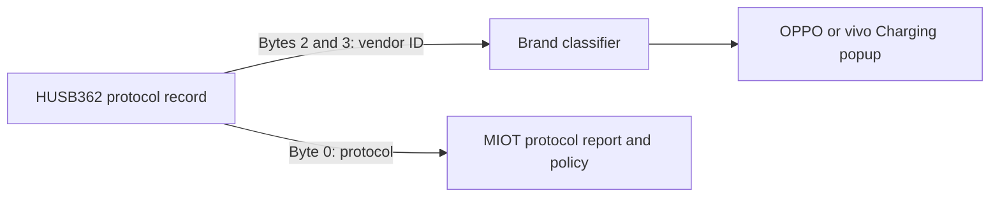

# OPPO, vivo and proprietary protocols: 0073 audit

2026-10-14, stage 13. Target raw SHA-256:
`65d96d0f6138a36fc62ce62325d055f934dac40d67bc31720f8182ebf5c80ce1`.
All checks use the firmware. No protocol meter was available. The audit uses
emulation of the original instructions and kept static code. No charger,
controller bus, ROM, login or peripheral was run or contacted.

## Conclusions and label decisions

| Question | Evidence | Decision |
|---|---|---|
| Can the main firmware recognize OPPO? | Classifier `0x406364` maps controller-reported ID `0x22d9` to class 4; name table entry points to `OPPO` | Confirmed classifier/display feature, not protocol detection |
| Can it recognize vivo? | Same classifier maps `0x183d` to class 5; name table points to `vivo` | Confirmed classifier/display feature, not FlashCharge detection |
| Does the brand depend on protocol? | Original-instruction sweep: both ports, every protocol byte, OPPO/vivo/zero IDs | OPPO/vivo results are independent of the protocol byte in this classifier |
| Is VOOC possible with HUSB362? | Chip manufacturer's announcement explicitly lists configurable VOOC | Chip-level capability confirmed; CUKTECH's controller configuration remains unproved |
| Does AD1204U 0073 expose a VOOC/SuperVOOC or vivo FlashCharge/VFCP mode? | No explicit names or code-to-name association found in the scoped main-image/controller-interface audit | Unresolved; no active-protocol app labels added |
| Could OPPO/vivo fast charging use UFCS instead? | Named UFCS controls in this firmware; CTTL documents UFCS products from both brands | Plausible for compatible devices; not a negotiated-session observation |

The Hynetek announcement says that the programmable DPDM PHY of the HUSB362 can
be set for VOOC and for some other protocols. The announcement does not give the
CUKTECH controller build, licensing/configuration, SuperVOOC generation or
protocol enum:
[manufacturer HUSB362 announcement](https://en.hynetek.com/2602.html).

OPPO describes VOOC as adapter/terminal communication for direct charging. This
is a different claim from the identification of a vendor ID:
[OPPO technical paper](https://www.oppo.com/content/dam/oppo/en/mkt/newsroom/story/flash-charging-technical-pape/OPPO%20Flash%20Charging%20Technical%20Paper.pdf).
The vivo iQOO 10 page makes a difference between FlashCharge and PD/PPS
compatibility:
[vivo product description](https://m.vivo.com.cn/vivo/iqoo10/).
CTTL reports certified UFCS products from OPPO and vivo:
[CTTL report](https://gma.caict.ac.cn/en/plat/cttl-t/major-mobile-phone-manufactures-in-China-fully-support-ufcs-fast-charging).
None of these sources shows which mode a given charger negotiated.

## Exact path from brand to display

1. The C1/C2 driver `0x414dac` reads HUSB362 command `0x83`. The six-byte record
   contains protocol byte 0 and the controller-reported vendor ID in bytes 2..3.
2. The polling function `0x40a718` updates that record through `0x405e5c`. The
   cache is at `0x2000c998 + port*6`. The power controller does the identity
   handshake. This summary-reading code does not show that handshake.
3. `0x406364` tests the ID word. The OPPO comparisons are at
   `0x4063ca..0x4063d4`. The vivo comparisons are at `0x4063be..0x4063c8`.
   Both return a constant class and do not read the protocol byte.
4. The UI loop `0x4065c8` sends the class to `0x406a74` → `0x41f77c`. This
   occurs only under some activity, screen and update conditions. `0x41f77c`
   stores the brand at widget offset `+0x38` and the cable value at `+0x3b`.
   Then it selects screen 3.
5. The renderer `0x40d700` prints `Charging`. It uses an index into seven
   brand-name pointers at `0x40d850` and formats `%dA Cable`. Class 4 gives
   ASCII `OPPO` at `0x475a1e`. Class 5 gives `vivo` at `0x475c5e`. This renderer
   does not print a VOOC or FlashCharge protocol name.

The mapped callers of the classifier are the UI loop and the load classifier
`0x406b78`. The load classifier checks Apple class 2 for one power-policy case.
No OPPO- or vivo-specific protocol-selection branch was found in these caller bodies.
This result applies only to these direct call sites. Computed or indirect paths
are not included.

## Verification with the original instructions

[VerifyBrandClassifier.java](../../scripts/ghidra/VerifyBrandClassifier.java)
emulates only `0x406364..0x4063fc`. It makes synthetic records for C1 and C2
with ID `0x22d9`, `0x183d` or zero. It tests all protocol byte values 0..255.
Each fixture starts with a new emulator state. The observed results come only
from the emulator, not from a host model of the classifier.

| ID | Fixtures | Observed class |
|---|---:|---|
| `0x22d9` | 512 | 4 for every protocol byte |
| `0x183d` | 512 | 5 for every protocol byte |
| Zero | 512 | 1 only for protocol 9; otherwise 0 |

All 1,536 results agreed with the expected branch behavior, over 71,168
original instruction steps. The emulator stops before the expected BX LR, after
it calculates the result. It does not emulate return instructions.

These are synthetic classifier cases. Some byte values can possibly never occur
in a real controller reply. The cases do not prove these items:

- Bus acceptance.
- Popup visibility in every state.
- Authentic phone identity.
- Supported charging modes.

A separate check compared the kept 160-byte classifier/literal window with the
raw image, and they agreed. Window SHA-256:
`8a6e19862834076130f2c088d13feb8691d0a0fff3cd3f4ec0258ddaa041feea`.
Local outputs: `artifacts/firmware/brand-classifier-verification-20261014-verified/`.
`verification.json` SHA-256:
`b44c99ebf688db0e59c288f11dcd9238844d827da69aa52d48a14bd7127c693b`.
`cases.jsonl` SHA-256:
`db5d9780c9b49da544069e76449b46f035824f7a3392231ea291a7a8565faac3`.
There are no live hardware observations.

## Limits of the protocol and control search

Case-insensitive byte searches covered the full 495,656-byte raw image and the
verified 44,744-byte startup expansion. UTF-8 and UTF-16LE searches found none
of these strings: `VOOC`, `SUPERVOOC`, `SVOOC`, `FlashCharge`, `VFC`/`VFCP`,
`SFCP`, `MTK`, `PE2.0`, `PE1.1`, 闪充, 超级闪充. The raw image has one ASCII
OPPO name and one vivo name, at the addresses above. Missing strings do not
prove missing protocol support. Chip negotiation code, unnamed enums and
glyph-based text are not covered by a string search.

The initializer `0x409e84` takes four C1/C2 enable parameters: miPPS, UFCS, PD,
PPS. It changes the related disable bits 0, 2, 3, 4 and keeps mask `0xe2`.
`0x40a5f4` makes the four-byte power-mode record consistent. Then `0x414f90`
writes command `0x81`. The kept or reserved bits are not identified as
VOOC/VFCP switches. The temporary bit-1 reconciliation path is not a newly
confirmed protocol enable. The named setters for C3/A are UFCS/SCP only.

The [stage-18 verification](protocol-command-blob-followup.md) corrects the
earlier inferred argument order of the initializer. Its logger prints PPS
before PD, because it changes the order of those two stack arguments on
purpose. Original-instruction checks across all 8,192 combinations of enable,
original byte and port confirm the PD/PPS labels in the app. The returned
protocol enums are a separate topic.

Thus there is no recovered remote VOOC/FlashCharge switch and no active enum
definition that the app can show. This does not prove that the secondary
controller cannot negotiate one by default. Useful next evidence:

- The matching controller firmware or command definition.
- A protocol-specific branch that names the returned enum.

Brand, voltage, wattage and cable-current labels alone do not close this gap.

> **Local outputs:** paths under `artifacts/` refer to local, git-ignored files
> (downloaded vendor packages and outputs regenerated by the tools in `scripts/`).
> They are not part of this repository; hashes are recorded for reproducibility.
