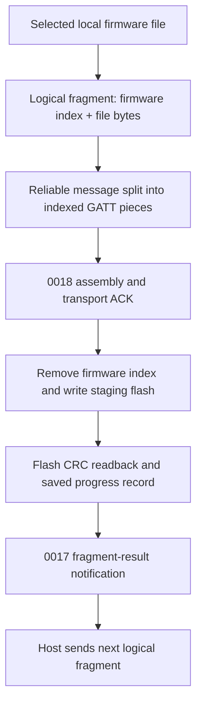

# Native OTA transfer framing and firmware correlation

Offline analysis, 2026-10-15. The update route of the official AD1204 plugin
was followed into Chinese Mi Home 11.7.709. Then it was compared with the
receiver in AD1204 firmware 2.1.2_0073. The sender and the receiver agree on
these items:

- the endpoints;
- the control envelopes;
- two independent sequence numbers;
- the commit acknowledgements;
- the prefix-CRC resume.

This closes the main static framing questions. No custom updater was tested,
and recovery after an interruption is not known.

Companion reports: [receiver and activation](ota-firmware-receiver-followup.md),
[download validation, retries and completion](ota-validation-recovery.md),
and [plugin entry/authentication](plugin-debug-and-upgrade-followup.md).
There was no cloud request, device connection, OTA command or flash operation.

Later implementation: the [CUKTECH App 0.7.0 installer](in-app-flasher.md)
uses this framing with careful negotiation and more response checks. It is not
tested on physical hardware.

## Artifact and source identity

The host APK SHA-256 is
`73335d3c17dff3e73097db7e2f86a373b7eb2c67611dc82749883ab2da3f0b6e`.
The source paths and line numbers below refer to
`artifacts/mihome-cn-20261015/analysis-8g/decompiled/sources/`.
JADX 1.5.6 gives reconstructed Java. It is not the original source. Where its
fragment branches did not agree, the exact DEX instructions were checked.

`classes13.dex`, extracted from that APK, is 10,387,868 bytes, SHA-256
`f102f462e1d01e52726eadc3faa86738a3f4946ceadf2718c58f6fa950896860`.
The targeted results are kept under
`artifacts/mihome-cn-20261015/ota-transfer-20261015/`.

The controlling class is
`com/xiaomi/smarthome/core/server/internal/bluetooth/mesh/OooO00o.java`
(the `MeshDfuManager` implementation). The presenter gets to it through
`_m_j.du0` → `XmBluetoothManager.startBleMeshUpgrade` →
`CoreApiStub.startBleMeshUpgrade` → Bluetooth server
`OooO0o.OooO0o0` (lines 989–1069). The word "mesh" in these API names does not
change the standard-auth connection selection, which was found separately.
Runtime selection and catalog changes were not observed on this charger.

## Endpoints and three layers

`_m_j/gw0.java` defines service FE95, control 0017 and data 0018.
`_m_j/yr7.java:27–40` sends reliable-channel packets through 0018 with
write-without-response, also in batched writes. The manager sends command
requests through 0017 with a write with response. It subscribes to both. The
receiver registers the same UUIDs independently.



All multibyte integers in these packet fields are little-endian. `len` counts
the payload that follows. It does not include its own header.

| Layer / direction | Fields | Meaning |
|---|---|---|
| 0017 request, host → charger | `command:u16, len:u8, params` | DFU command; host caps params at 17 bytes |
| 0017 response, charger → host | `01, len:u8, command:u16, status:u8, params` | Command completion |
| 0017 fragment result, charger → host | `02, 03, status:u8, firmware_index:u16` | Flash-fragment result |
| 0018 reliable start, host → charger | `00 00 00 00, piece_count:u16` | Zero sequence, start opcode 0, package type 0 |
| 0018 data, host → charger | `piece_index:u16, message_slice` | One-based piece index within this message |
| 0018 ACK, charger → host | `00 00 01, status:u8, [missing_piece_indices:u16...]` | Ready/completed/missing-piece status |
| Assembled logical message | `firmware_index:u16, file_bytes` | One-based index within the firmware file |

The piece index starts again for each reliable message. The firmware index
continues across the image, and the resume uses this saved index. Do not merge
the two counters into one counter. The kind/length envelope of the 0017
response is real wire data. The notification arguments of the receiver confirm
it independently.

The manager function `OooOOo()` makes one logical fragment at a time from the
selected local file. This method copies the file bytes without change. It does
not decompress, it does not remove the signed wrapper and it does not pad the
fragments. This shows how the selected file is sent. A live selection or
transfer of a specific package was not observed. `_m_j/bs7.java` allocates a
ten-fragment read buffer and a `fragment_size + 2` send buffer. The short last
fragment allocates only `remaining_file_bytes + 2`.

### The last-fragment ambiguity in the decompiler output

The branch placement in the ordinary and simple Java reconstructions is
confusing. The exact `OooOOo()V` DEX code gives the answer:

- offsets `0x88–0xa4`: a full fragment copies to output offset 2;
- `0xa5–0xbc`: a short fragment allocates `remaining + 2`, copies to offset 2,
  and joins the same path;
- `0xbd–0xd3`: both paths write the low/high firmware index bytes into output
  offsets 0/1 and increment the firmware counter;
- `0xd5–0xdf`: the code marks sending as complete when the consumed byte count
  gets to the file length. The last message is still sent before the next
  switch.

The generated smali SHA-256 is
`4d0fcd296f6b08d29f172ee3c2a881f75c1ba3aee2d69cc95c3505b0f232e694`.
The baksmali CLI that is bundled in the existing JADX JAR made it:

```powershell
& '%USERPROFILE%\scoop\apps\temurin21-jdk\current\bin\java.exe' `
  -cp 'artifacts/re-tools/jadx-1.5.6/lib/jadx-1.5.6-all.jar' `
  com.android.tools.smali.baksmali.Main disassemble `
  --classes 'Lcom/xiaomi/smarthome/core/server/internal/bluetooth/mesh/OooO00o;' `
  --code-offsets `
  -o 'artifacts/mihome-cn-20261015/ota-transfer-20261015/smali-dfu-manager' `
  'artifacts/mihome-cn-20261015/ota-transfer-20261015/classes13.dex'
```

## Piece sizing, ACKs and retries

`_m_j/wt1.java:78–135` takes the logical message and calculates
`ceil(message_length / negotiated_piece_payload)`. For this manager,
`yr7.OooO0oO() == false` disables its optional extra CRC32. This does not
disable the flash/readback CRC, the resume CRC, the package MD5 or the device
authentication. `wt1.OooO0oO`, lines 153–194, serializes each piece as a
two-byte index and its slice. The last slice has its real length.

`z71.o000000O` serializes the start packet. `o00Oo0` serializes the ACKs.
`tx6.OooOoO0`, lines 172–211, reads the status as follows:

- 1: the receiver is ready; send all pieces;
- 5: send the listed missing pieces again;
- 0: complete the reliable-channel write and reset that channel state;
- other statuses: the channel operation fails.

The successful reliable-write callback of the manager does not send the next
firmware fragment. The next fragment waits for 0017 event kind 2/status 0. The
receiver `0x0041f14c` completes the reliable assembly. Then `0x0041b7ec` calls
the flash commit/readback `0x0041b274`. Only the success of the flash commit
queues that event. Thus a reliable ACK alone does not prove that the fragment is
in flash.

The transport paths use six-second timers (`wt1`, also lines 187 and 355–364).
Their callbacks are specific to the state. The manager also uses a separate
twenty-second command timeout (`OooOOOo`, lines 604–633). These timers are not
one deadline for the whole update. In this manager, a disconnected connection
makes the operation fail with `-101`. That branch shows no automatic reconnect
or rollback. Download retries and later scan retries are in a separate
document.

The fragment size is not simply the ATT MTU. Receiver command 2 uses a reliable
payload that is negotiated separately. A payload below 19 bytes selects
512-byte file fragments. A payload of 19 or more selects 2,048. The default
reliable payload is 18. Its local upper limit is 242, through the `0xa4`
parameter exchange. The default of the host channel is also 18. The host
channel has MTU and peer-payload caches. A successful Android MTU request alone
does not show that the peer parameter changed.

For the kept 496,995-byte signed package, the calculation gives:

| Example negotiated payload | File fragment size | Logical fragments | Last file fragment | GATT pieces per full / last logical fragment |
|---|---|---|---|---|
| 18 | 512 | 971 | 355 bytes | 29 / 20 |
| 242 | 2,048 | 243 | 1,379 bytes | 9 / 6 |

These are calculated examples. The piece counts include the logical two-byte
index. They are not observed negotiated values, throughput or captured packets.

## Resume and activation

After the notification setup, the normal-image flow sends protocol command 1.
`_m_j.f3b` accepts versions up to 4. Command 2 gets or prepares the fragment
size. For protocol version 2 or higher, command 3 gets the last index and the
CRC. The receiver in this firmware reports protocol version 4.

The optional command 7 is a stateful integrity option. When the low bits of its
one-byte value are `01`, command 3 calculates the saved prefix CRC again from
the staged bytes. Command 1 clears the context flag. In the inspected handler,
command 3 does not clear it. This option is in the generic command table of the
receiver. It is not in the normal update sequence of the traced sender. The
full branch evidence and the limits are in the
[optional DFU callback report](dfu-auth-followup.md).

`_m_j/as7.java:64–99` and manager `OooO00o`, lines 349–401, implement the resume
guard. For a nonzero index, the host calculates CRC32 over the first
`min(fragment_size * last_index, file_length)` bytes of the selected file:

- If the CRC does not agree, the transfer starts again from firmware fragment 1.
- If the CRC agrees, the host skips that many file bytes. It sets the next index
  to `last_index + 1` (`OooO0O0`, lines 403–438).
- Index zero starts a new transfer.

This is an integrity check of the file prefix. It does not prove that the image
can boot. Receiver index 1 resets the rolling CRC and the count, so the restart
behavior agrees. The sixteen-byte saved record of the receiver contains the
index, the CRC and the byte count. See the companion report for the NVDS mapping
and the staging limits.

An offline check extracted all 256 literal CRC table entries from
`_m_j/cm6.java:73`. It applied the complemented-seed/table recurrence of the
host to the kept signed file. At each 512- and 2,048-byte fragment boundary,
also at the short last fragments, the rolling value agreed with Python
`zlib.crc32(file[:prefix_length])`. 1,214 prefix comparisons passed
(971 + 243). First 512 bytes: `c299b136`; first 2,048: `bafb084f`; whole signed
file: `9f0ab94b`. This checks the CRC arithmetic against an independent
implementation. It is not a real device checkpoint or a resume test.

WARNING: Command 4 deletes the persistent resume record. It is not a harmless
status read. It is not a resumable end-of-transfer checkpoint.

After the last flash-fragment event, the next sender step sends command 4 with
`01 00 00 00`. This is a little-endian integer 1, made by `wf6.OooOoo0`. The
receiver reads it as a one-second switch delay. But it starts the timer only
after a disconnect clears the switch gate. Command 4 copies and then deletes
the persistent resume record before the last activation checks.

The device signature validation, the staged-byte readback, the CRC and the
boot-record preparation are recovered. The bootloader/ROM copy/swap, the
rollback and the power-loss recovery are not in the supplied image. For the
primary image, the last success screen of Mi Home depends on finding the
matching MAC again. That completion callback does not read the running version
again. The optional MCU path has different version handling. It is not a known
AD1204 controller update route.

## Host robustness limits and remaining work

The host parser has two visible weaknesses. Do not copy them into a future
client:

1. `as7` checks only two bytes before it reads the six-byte index/CRC result.
2. The manager parses a fragment-result index, but it goes to the next fragment
   on status zero without a comparison of that index with the pending fragment.

These are static source findings. They are not reproduced device faults or
claims of exploitability. A future implementation must check the exact length,
the expected command and the pending index.

These gaps are still open:

- an authenticated OTA capture for this charger;
- tested interruption and resume behavior;
- a new check of the running version after reboot;
- independent ROM/bootloader recovery evidence.

The optional commands 5/6 and the generic MCU UI do not prove that
secondary-controller flashing is possible. This document added no app flasher
and no new charger setting.

## Selected reconstructed-source hashes

| Relative source | SHA-256 |
|---|---|
| `com/xiaomi/smarthome/core/server/internal/bluetooth/mesh/OooO00o.java` | `9435c586e1a1c39a1ae109296bd9c67c723d8d88a6748a65aad2ccbad9acf14f` |
| `_m_j/wt1.java` | `9b8d933ae0bec4ab1a423c102dc0732e9683fdddd308d3f3b7327d04f23c9887` |
| `_m_j/tx6.java` | `2ba41d053170e20cadaff094a968a83c848666663e38f551cc29ebf1d0912abf` |
| `_m_j/z71.java` | `94795c9bb349c807aaa83de0e89c5810c704523b2cc48c13c0ef136babd8cb01` |
| `_m_j/o00Oo0.java` | `56e4712c47944c083a5b2dc8f2b3430970976740cb633b9a6d4cdcb0432e24fa` |
| `_m_j/yr7.java` | `77e1474a5f649525f70ac95f199caa96f426889b0753362bbca642aabadb6873` |
| `_m_j/as7.java` | `e7109cb5aa60fecc3c2c12fcafdf8807c3b593f62f3d3598212bb9201b2f9c0f` |
| `_m_j/bs7.java` | `9d75bd3723fa1654da43c31c3e2adead4e3f04f857c3f2e5eb089a29332209d8` |
| `_m_j/gw0.java` | `e987db4837c4c99b4b3730c8696dae06ce7ae0737d96161258a5858489b99354` |

> NOTE: Paths under `artifacts/` refer to local files that git ignores. These
> files are downloaded vendor packages and outputs that the tools in `scripts/`
> make again. They are not part of this repository. The hashes let you
> reproduce the results.
